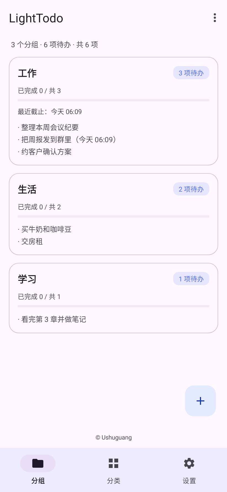
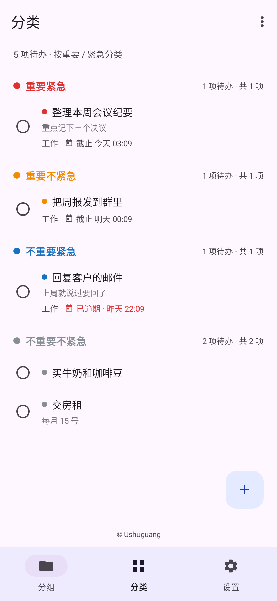
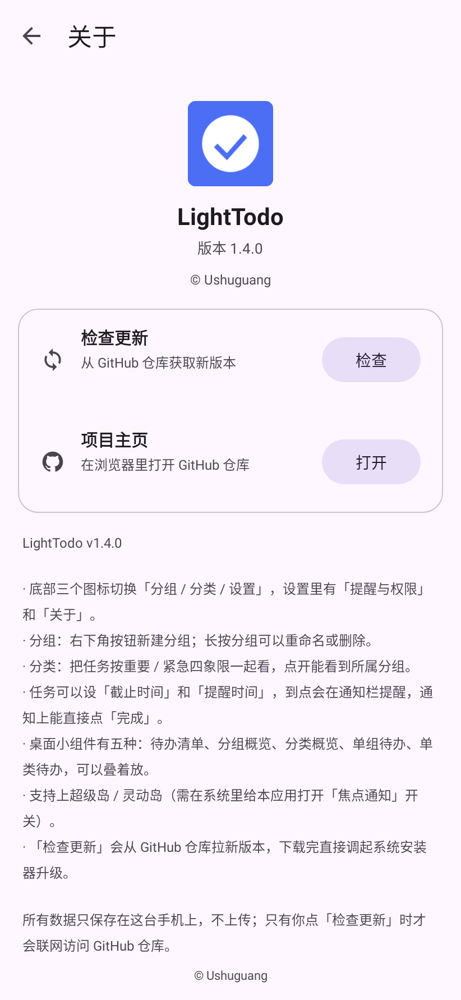

# LightTodo

分组待办 App，专为小米澎湃系统（HyperOS）设计。

<p align="center">  </p>

## 功能

- **分组**：自定义分组，任务完成后沉底但分组不消失；长按分组可重命名 / 删除。
- **分类**：重要 / 紧急四象限分类，红 / 橙 / 蓝 / 灰四色标记，可跨分组查看全部任务；点开任务能看到所属分组。
- **截止时间与提醒**：到期标红「已逾期」，定时提醒发到通知栏，通知上可直接点「完成」。
- **题目**（v1.8.0 新增）：自建题目分类，攒下不会的题等有空去问老师；支持文字、拍照、从相册选图，拍照/选图无需运行时权限，图片只存本机。
- **桌面小组件 6 种**：待办清单 / 分组概览 / 分类概览 / 单组待办 / 单类待办 / 自定义清单，可堆叠、实例独立、宽度够自动两栏、右上角一键刷新。
  **尺寸没有上限**，可自由拖拽缩放；拖得越矮会自动切到紧凑 / 极简排版，照样能显示任务，底部不留大片空白。
- **自定义清单小组件**：添加时直接选「全部任务 / 某个分组 / 某个四象限分类」。
- **超级岛 / 灵动岛**：提醒按小米官方《超级岛推送指南》附带焦点通知参数。
- **软件内检查更新**：从本仓库的 GitHub Release 拉新版本，下载完直接调起系统安装器升级。

## 隐私

所有待办数据只保存在手机本地（应用私有目录），**不上传、无广告、无第三方 SDK**。
唯一的联网场景是用户主动点「检查更新」时访问 GitHub 仓库。

## 自己构建

```bash
./gradlew assembleRelease        # 产物：app/build/outputs/apk/release/app-release.apk
./gradlew testReleaseUnitTest    # 跑单元测试
```

需要 JDK 17、Gradle 8.7（wrapper 自带）、Android SDK 34。
工程内已附带签名文件 `lighttodo.jks`（口令 `lighttodo`），保证自建包与已发布包签名一致、可覆盖升级。

## 发布新版本

1. 改 `app/build.gradle` 里的 `versionCode` / `versionName`。
2. 提交并打 tag：

   ```bash
   git tag v1.8.0
   git push origin main --tags
   ```

3. `.github/workflows/release.yml` 会自动构建 APK 并创建 Release。
4. 用户在 App 里点「检查更新」即可收到。

## 技术栈

原生 Android · Java · Material 3 · minSdk 26 / targetSdk 34 · 无第三方依赖

## 许可

© Ushuguang
